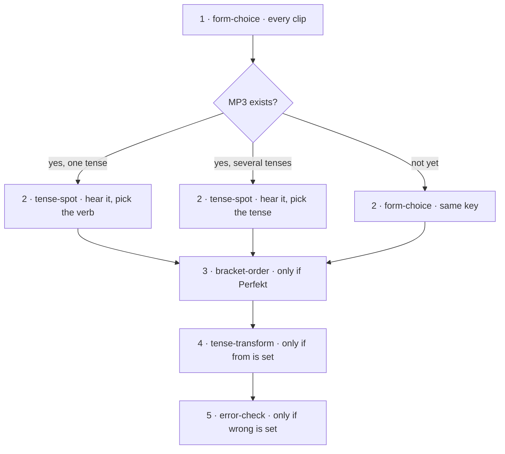
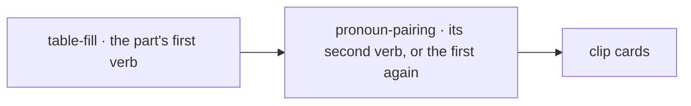

# Grammar world

Status: first build. One tab with content (Động từ), one stage (Verbkonjugation, opened by A1.1 Lektion 3). The Lektion path is unchanged: A1.2 Lektion 1 keeps its Luyện ngữ pháp node for now.

## What the learner sees

- **Lesson button**: when a stage opens, a purple mountain button sticks to the bottom right of that Lektion's path, above the tab bar. It is not a node on the path. Until the first part of that stage is finished, a hint centered on the button says "Luyện ngữ pháp của nút này". The hint may extend past the path. The first tap opens `/grammar?intro=<topic>&from=<path>`: a short tour, then *Bắt đầu phần 1*. After a part of that stage is finished, the same button opens the mountain and the hint is gone.
- **Portal**: the same button, fixed at the bottom right above the tab bar, on CEFR level paths that do not contain the opening Lektion. A red badge counts open stages with nothing practised; otherwise a thin gold ring shows the stars collected.
- **Mountain** (`/grammar?tab=<area>&from=<path>`): tabs are areas, each with its stars, a check when done, or a lock. It opens on the tab of the newest open stage, scrolled to the next unfinished stop. Stops climb bottom to top: practice nodes, then one review node per stage. A locked stage waits in fog with a button to its Lektion. The current stage's banner is the ground at the bottom. The first time a tab is finished, Pingu plants a flag; after that the banner says "Ôn lại để giữ đỉnh".
- **Practice** (`/grammar/practice?topic=&node=&part=` or `&review=1`): the same session as a Lektion grammar node, with three hearts. The first miss on a card costs one; the card stays until the answer is right. Running out ends the part without saving it. A finished part goes back to the mountain, where a star is added to the tab and the next stop lights up. Every finished part and every review pays 20 XP, including a replay. Running out of hearts pays nothing.

## Authoring: `src/data/grammar/world.json`

Everything is written by hand. Nothing is collected or sorted across levels or Lektionen.

```jsonc
{
  "areas": [                                   // tabs, left to right
    {
      "id": "dong-tu", "titleVi": "Động từ", "titleDe": "Verben",
      "icon": "bolt",                          // Material Symbols name
      "topics": [                              // stages, from the foot of the mountain up
        {
          "id": "verbkonjugation",             // stable: progress is saved under it
          "titleVi": "Chia động từ", "titleDe": "Verbkonjugation",
          "opensWith": "a1-1/lektion-3",       // first practice node of this Lektion opens the stage
          "tenses": ["praesens"],              // warm-ups and listening stay inside these
          "verbs": ["machen", "kommen"],       // warm-up tables; must be in tenses.json
          "tips": [{ "id": "endungen", "tense": "praesens", "titleVi": "…", "textVi": "…" }],
          "clips": [
            {
              "id": "vk-01",                   // stable: never reuse or renumber
              "filename": "vk-01-ich-komme-aus-vietnam.mp3",
              "script": "Ich komme aus Vietnam.", "translationVi": "Tôi đến từ Việt Nam.",
              "verb": "kommen", "tense": "praesens", "person": "ich",
              "from": "Wir kommen aus Vietnam.",                         // optional → tense-transform
              "wrong": { "script": "Ich kommst aus Vietnam.", "whyVi": "…" }, // optional → error-check
              "tip": "…"                                                  // optional, after a mistake
            }
          ]
        }
      ]
    }
  ]
}
```

Clip audio: `public/audio/grammar-world/<topic id>/<filename>`, ElevenLabs voice "Theo Teacher" (`TIKjTeWOFujJEvXK1qIU`), model `eleven_multilingual_v2`, one take per line. `npm run check:content` checks the file, the opening Lektion, verbs, tenses, persons, that the verb form is in the script, and orphaned MP3s.

## Cards

One clip gives 2–4 cards. They are dealt in this order; a clip without that field skips the card. The clip's seed changes the options, not the kinds.



`error-check` shows the wrong line for about half the clips and the right line for the rest, so "Sai" is never a sure answer. The listening slot keeps the key `tense-spot` before the MP3 exists, so adding audio later keeps every saved part.

Each part opens with two warm-ups from the verb tables, then the clip cards of that slice:



What the learner sees, before an answer. The lines are from Verbkonjugation, except Perfekt word order and the several-tenses listening card, which this stage does not deal yet.

```text
form-choice
+--------------------------------------------+
|     o                                      |
|    /|\   NGỮ PHÁP · CHỌN DẠNG ĐÚNG         |
|    / \   Ich ______ aus Vietnam.           |
|          "Tôi đến từ Việt Nam."            |
|                                            |
| [      kommst      ] [       kommen      ] |
| [      komme       ] [       kommt       ] |
+--------------------------------------------+

listening slot · one tense
+--------------------------------------------+
| NGHE · HÖREN                               |
| Bạn nghe thấy động từ nào?                 |
|                                            |
|         |     |  |    |    |               |
|    | |  |  |  |  | |  | |  |  |            |
|  | | |  |  |  |  | |  | |  |  | | |        |
|                ( > )                       |
|                                            |
| [      kommst      ] [       komme       ] |
| [      kommen      ] [       kommt       ] |
+--------------------------------------------+

listening slot · several tenses
+--------------------------------------------+
| NGHE · HÖREN                               |
| Câu này ở thì nào?                         |
|                                            |
|         |     |  |    |    |               |
|    | |  |  |  |  | |  | |  |  |            |
|  | | |  |  |  |  | |  | |  |  | | |        |
|                ( > )                       |
|                                            |
| [ Präsens ]  [ Präteritum ]  [ Perfekt ]   |
+--------------------------------------------+

bracket-order
+--------------------------------------------+
| PERFEKT · SATZKLAMMER                      |
| Dịch câu này sang tiếng Đức                |
| Tôi đã đi về nhà.                          |
|                                            |
| __________________________________________ |
|                                            |
| Chạm vào từ theo đúng thứ tự               |
|                                            |
| [nach]  [bin]  [gegangen]                  |
| [Ich]  [Hause]  [habe]  [gekommen]         |
+--------------------------------------------+

tense-transform
+--------------------------------------------+
| ĐỔI CÂU · UMFORMEN                         |
| Đổi câu cho đúng nghĩa mới                 |
| Ich komme aus Deutschland.                 |
| → Bạn đến từ Đức.                          |
|                                            |
| __________________________________________ |
|                                            |
| Chạm vào từ theo đúng thứ tự               |
|                                            |
| [kommst]  [aus]  [Du]                      |
| [Deutschland]  [Ich]  [komme]              |
+--------------------------------------------+

error-check
+--------------------------------------------+
|     o                                      |
|    /|\   CÂU NÀY ĐÚNG HAY SAI?             |
|    / \   Ich kommst aus Vietnam.           |
|                                            |
| [       Đúng       ] [        Sai        ] |
+--------------------------------------------+

table-fill
+--------------------------------------------+
| ĐIỀN BẢNG · TABELLE          ( Präsens ) |
| kommen  “đến”                            |
|                                            |
| ich          komme                         |
| du           ______                        |
| er/sie/es    kommt                         |
| ihr          ______                        |
| wir          kommen                        |
| sie/Sie      ______                        |
|                                            |
| [kommst]  [kommt]  [kommen]  [komme]       |
+--------------------------------------------+

pronoun-pairing
+--------------------------------------------+
| GHÉP TỪ · WÖRTER ZUORDNEN    ( Präsens ) |
| kommen  “đến”                            |
| Chạm một từ mỗi cột.                       |
| Đúng thì xanh ngay, sai thì thử lại.       |
|                                            |
| [        du        ] [       kommt       ] |
| [       ich        ] [       kommen      ] |
| [       wir        ] [       kommst      ] |
| [    er/sie/es     ] [       komme       ] |
+--------------------------------------------+
```

## Nodes and parts

All clip cards, in clip order, form one stream. Every clip deals from its own seed, so adding clips only adds cards at the end of the stream.

- A node holds 4 parts. A part in nodes 1–2 is 10 cards; from node 3 on it is 15. Two of each part's cards are the warm-ups.
- A node ends on a clip, so the next node starts on a new one. The same clip is never in two practice nodes; only the review deals it again. One or two cards of the last clip can lengthen the last part. A clip that would open a fifth part starts the next node.
- The last node can have fewer parts. A tail of fewer than 3 cards joins the part before it.
- When the learner finishes a node, its end in the stream is stored. Clips added later start a new node above it, below the review. A finished node keeps its parts even when it had fewer than 4.
- The review node deals 15 cards: one card per clip in turn, across every clip of the stage. It opens when every node is done. Each replay draws again and takes in new clips. Once played, it stays done.

## Opening

A stage opens when the learner finishes the first practice node of its `opensWith` Lektion: every part of that node is stored, or every clip in those parts is completed, or the Lektion's listening is finished. The learner also needs access to that level. Admins and teachers see every stage of their courses open, as on the Lektion path.

## Progress

`StoredProgress.grammarWorld` (merged like the rest of the progress document):

- `stages[topicId]`: `partKeys` (finished parts; a key is a hash of the part's card keys), `nodeEnds` (stream end of each finished node), `reviewRuns`, `announcedAt` (new stage screen shown).
- `summits[areaId]`: when Pingu planted the flag.

A finished part or review counts as a practice day (streak) and as exercises in the visit log, under the lesson key `grammar-world/<topic>`.

## Code

- `src/lib/grammar-world.ts`: cards, nodes, review, stage and area views, opening. Tests in `grammar-world.test.ts`.
- `src/lib/grammar-world-progress.ts`: stored shape, merge, normalize.
- `src/lib/grammar-world-content.ts`: loads world.json, resolves audio and each topic's gate on the server.
- `src/components/grammar-world/`: `GrammarPortal` (button, new stage screen, star flight), `GrammarWorldClient` (mountain), `GrammarWorldSession` (practice), `WorldArt` (icons and drawings).
- Lektion practice now scopes the verb tables to its own verbs (`scopeTables`), so new verbs in `tenses.json` never change a Lektion's cards or part keys.

## Open

- Content of Verbkonjugation is a draft for teacher review.
- No XP or quests for the grammar world yet. The student detail shows stages and flags, and an owner can delete them.
- The A1.2 Lektion 1 practice node still sits on the Lektion path.
